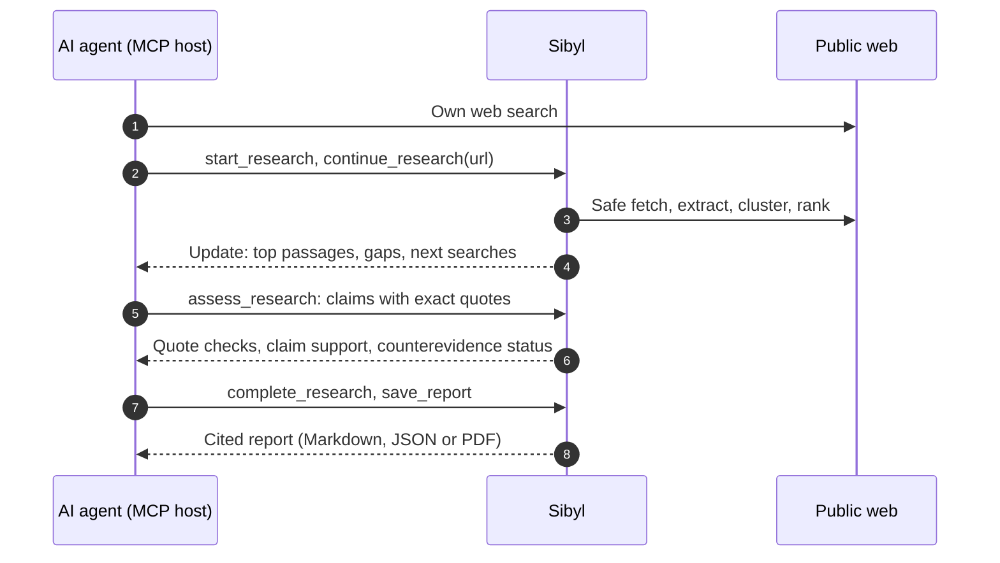

<!-- mcp-name: io.github.chriswu727/sibyl -->

<p align="center">
  
</p>

<p align="center">
  <a href="https://github.com/chriswu727/sibyl/actions/workflows/tests.yml"></a>
  
  
  
  <a href="LICENSE"></a>
</p>

<p align="center">
  <b>English</b> · <a href="README.zh-CN.md">简体中文</a>
  <br>
  <a href="#quick-start">Quick start</a> ·
  <a href="#how-it-works">How it works</a> ·
  <a href="#research-workflow">Workflow</a> ·
  <a href="#quality-and-limitations">Evaluation</a> ·
  <a href="docs/README.md">Docs</a>
</p>

**A research MCP for your AI agent: investigate across sources, inspect evidence,
track counterevidence and gaps, and export a cited report when needed.**

Your agent does the searching and thinking. Sibyl gives it a persistent research
workspace alongside its own search; it does not replace it. Connect it to a local
MCP-capable agent you already use, including one backed by a subscription. Sibyl
does not call another generative model, read subscription credentials, or require
a second model API key. The host's own usage rules still apply.

> [!NOTE]
> **Status (2026-10-28): development paused; no stable release is planned.**
> The preregistered paired evaluation did not pass in either of two runs:
> pooled, an agent using Sibyl cited sources that supported its claims somewhat
> more often (79.4% against 74.9%) than the same agent with only built-in search,
> at about twice the cost, a difference within run-to-run noise
> ([details](#quality-and-limitations)). Agents' own research has caught up with
> what Sibyl set out to add. This README describes the source checkout; published
> beta 0.4.0b1 and stable 0.3.0 contain older architectures.

## What it does

A search call returns leads. Sibyl keeps the investigation connected.

| Step | What Sibyl does |
|---|---|
| **Plan** | Break a question into research questions and keep the plan across calls. |
| **Read** | Read the pages your agent finds into one evidence store, or search keylessly. |
| **Trace** | Inspect exact passages with stable identities, hashes and provenance. |
| **Check** | Reject fact claims whose quotes do not appear verbatim in the cited passage. |
| **Conclude** | Record supported, disputed or unresolved conclusions with evidence links. |
| **Challenge** | Investigate counterevidence and pursue specific gaps in later rounds. |
| **Deliver** | Reuse the structured review ledger directly, or export Markdown, JSON or PDF. |

The host chooses queries, reads sources and judges what they support. Sibyl
retrieves, preserves state, checks reference integrity and enforces budgets.
It does not decide truth for the host or run an autonomous researcher.

**When to use it:** when a conclusion must be checked or reused, such as a
decision that needs cited evidence, a comparison that should include
counterevidence, an investigation spanning several questions or sessions,
findings handed to someone else, or a report. For a quick fact lookup, your
agent's own search is enough: Sibyl adds steps, and pays off only when the
evidence trail matters.

## How it works



The default MCP surface has **eight tools**, compact structured briefs,
per-question updates after each read or assessment, and on-demand passage reads.
A research result does not need to become a long report before another agent
can use it.

## Quick start

Requires Python 3.11+ and a host supporting local stdio MCP. Install this source
checkout in a fresh environment:

```bash
git clone https://github.com/chriswu727/sibyl.git
cd sibyl
python -m venv .venv
.venv/bin/python -m pip install -e .
.venv/bin/sibyl-mcp --list-tools   # should list eight tools
```

Add Sibyl to your host's MCP configuration, replacing both paths with absolute
local paths. `SIBYL_OUTPUT_ROOT` is optional; without it, research is stored in
your per-user data directory and shared by your local sessions:

```json
{
  "mcpServers": {
    "sibyl": {
      "command": "/absolute/path/to/sibyl/.venv/bin/sibyl-mcp",
      "env": {
        "SIBYL_OUTPUT_ROOT": "/absolute/path/to/private-sibyl-research"
      }
    }
  }
}
```

Then ask your agent:

> Use Sibyl to investigate whether SQLite WAL fits a multi-process application.
> Inspect the original documentation, investigate limitations and counterevidence,
> and return evidence-linked conclusions with unresolved questions. Write a report
> only if I ask for one.

<details>
<summary><b>Windows, search keys and transport notes</b></summary>

- On Windows, use `.venv\Scripts\sibyl-mcp.exe`. Configuration syntax varies by
  host; the example is for clients accepting `mcpServers` JSON.
- Results arrive as MCP `structuredContent` mirrored as JSON text, so hosts that
  pass only text to the model still receive them. The former `--profile keyless`
  text surface was removed. This is not a remote HTTP MCP endpoint.
- No search key is required. Optional Tavily search has separate credentials and
  provider charges; subscription access to your agent does not pay for Tavily.
  See [installation and optional integrations](llms-install.md).

</details>

## Research workflow

| Tool | Purpose |
|---|---|
| `start_research` | Create a bounded job with focused sub-questions |
| `continue_research` | Read a URL your agent found, or search keylessly, into the job |
| `get_research` | Read the brief, exact passages in a batch, source catalog or full state |
| `assess_research` | Record the host's conclusion, support, challenges and gaps |
| `complete_research` | Optionally finalize a cited host-authored report |
| `save_report` | Export that report; Markdown is the default |
| `cancel_research` | Cancel work or explicitly delete a checkpoint |
| `gather_bundle` | Retrieve standalone evidence without creating a job |

1. **Start** with `question` and `sub_questions`.
2. **Read** sources found by your agent's own search with
   `continue_research(url=..., query=...)`; a query alone uses Sibyl's keyless
   search. Link each retrieval to `question_id`, and use
   `purpose="counterevidence"` for an actual investigation of alternatives. Each
   read returns an update with the new sources' top passages inline and the
   question's gaps and next searches.
3. **Inspect** exact text before assessing: the full brief omits raw text, so
   read up to twelve passages at once with `get_research(job_id, passage_ids=[...])`.
4. **Assess** with stable supporting/challenging passage IDs, a conclusion and
   claims. Facts link exact passages and quote them; Sibyl rejects a quote it
   cannot find in the cited passage. Reasoning links its premises,
   recommendations state criteria and assumptions, and unknowns stay explicit.
   See the [claim contract and complete example](docs/research-claims.md).
5. **Iterate** on the gaps in `research_plan` with a focused query and rationale,
   then reassess.
6. **Report** only if needed: `complete_research` with the current revision, then
   `save_report(job_id=..., format="md")`.

<details>
<summary><b>More on assessments, reports and recovery</b></summary>

Quote matching ignores only case, spacing, accent encoding and typographic
variants; numbers are never folded. Changes to a premise or new retrieval make
dependent judgments need reassessment. Use
`get_research(view="sources", revision=..., offset=0, limit=10)` to page evidence
outside the selected citation window.

For JSON as well as Markdown, call `save_report` again with `format="json"` and
use its returned path. Exports return a machine-readable manifest with confirmed
file paths, formats, sizes, hashes and per-format failures. Errors expose recovery
instructions and the current saved revision when available; rejected claims are
never silently accepted. See the [agent protocol](docs/agent-protocol.md#structured-recovery).

Sibyl renders the host-authored claims and citations, including their premises,
criteria and assumptions. Unknown and disputed claims remain visible even if
omitted from the selection. Old contract-1 jobs can no longer be finalized.
Citation validation checks targets, **not whether the text entails the claim**.
Incomplete research must retain its gaps; `allow_incomplete=true` yields a partial
report. A completed job means the report is finalized, not that its claims are true.

[Detailed workflow and limits](docs/USAGE.md#persistent-research-jobs) ·
[Machine-facing contract](docs/agent-protocol.md)

</details>

### See an investigation

[](docs/examples/sqlite-wal/README.md)

<p align="center">
  <a href="docs/examples/sqlite-wal/report.md">Read the report</a> ·
  <a href="docs/examples/sqlite-wal/sources.json">Inspect the evidence</a> ·
  <a href="docs/examples/sqlite-wal/README.md">Reproduce the replay</a>
</p>

This is a recorded-source MCP replay with host-authored reasoning, not a live
accuracy benchmark. It checks gap reviews, counterevidence, exports and restart.
The [ten-case live host suite](docs/examples/host-suite/README.md) separately
documents discovery failures, host-supplied URLs and explicit abstention.

## Optional capabilities

```bash
.venv/bin/python -m pip install -e '.[pdf]'      # text-PDF input; POSIX only
.venv/bin/python -m pip install -e '.[report]'   # PDF output, no model SDK
.venv/bin/python -m pip install -e '.[monitor]'  # authenticated loopback monitoring
```

Markdown and JSON export need no extra. `[extract]` supplies Trafilatura for
compatibility reads; `[rerank]` supplies optional local FlashRank ranking. The
default lexical ranker needs no model download. See [usage](docs/USAGE.md) and
[operations](docs/OPERATIONS.md). For inspection outside an agent, use
`sibyl gather "a focused question" --format json` or the async Python
`sibyl.gather_bundle` API. Neither generates an answer.

<details>
<summary><b>Upgrading from the old architecture</b></summary>

LiteLLM, model-provider configuration, autonomous execution, generic model
analysis, SWOT/timeline generation and finance/chart tools have been removed.
The `report` extra now means PDF rendering only. Sibyl serves one tool set; the
old `keyless`, `report`, `finance` and `full` profiles are rejected.

Install in a fresh virtual environment: upgrading a package does not uninstall
its old transitive dependencies. Remove old model settings from `SIBYL_CONFIG`.
Do not give Sibyl your host's login token. Existing checkpoints remain readable
and completed reports exportable; old autonomous jobs cannot resume execution.
Start a new host job to continue investigating. See [migration](docs/USAGE.md#migration).
The [legacy-boundary inventory](docs/MIGRATION.md) distinguishes removed execution
from retained checkpoint/report readers and historical evaluation evidence.

</details>

## Quality and limitations

The practical difference is **persistent, evidence-directed research**, not a
claim to have a better model. Every gate below was frozen before its run, and
failed runs are kept.

| Evaluation | Result |
|---|---|
| [Host-source retrieval gate](evals/results/host-source-retrieval-honest-ua-2026-10-27.json) (66 questions, three frozen URLs each) | Meets the amended gate: 87.0% answer coverage, 98.5% stability, 100% ready-state precision. Answerable readiness, 30.2%, became a reported diagnostic by owner decision. |
| [Paired host evaluation, run 1](evals/results/paired-host-2026-10-27/manifest.json) (20 tasks, blind judge) | Not passed: citation support 78.6% against 69.1% for built-in search, but counterevidence coverage scored lower (1.1 against 1.4). |
| [Paired host evaluation, run 2](evals/results/paired-host-rerun-2026-10-28/manifest.json) | Not passed: citation support 80.2% against 80.5%, and one factual task fewer. |
| Both paired runs pooled | Citation support 79.4% against 74.9% (77.5% against 67.4% counting unreadable pages); equal factual and trap results; about twice the cost. |
| [Keyless discovery](evals/results/live-retrieval-hedged-2026-10-27.json) (66 questions × 3, GitHub runner) | Failed: 74.1% coverage, 35.2% readiness, 48.5% stability, 90.5% ready precision; every trap handled safely. |

Built-in search alone moved 11 points of citation support between the two paired
runs, so single runs of 20 tasks do not resolve differences of a few points.

<details>
<summary><b>Full quality notes</b></summary>

The [first host-source run](evals/results/host-source-retrieval-2026-10-27.json)
had every Wikipedia read refused until page reads identified as Sibyl. In keyless
discovery, DuckDuckGo and Mojeek almost always refused requests from the
datacenter network. These retrieval gates use gold/alias evidence matching, not
semantic report accuracy. Seven of ten live host-suite cases needed host-supplied
URLs. Compact responses and model removal do not fix those discovery weaknesses.

A [two-workflow low-effort host retest](evals/results/host-agent-structured-retest-2026-10-26.json)
delivered partial Markdown/JSON for both tasks, but the SQLite recommendation
still cited an excerpt missing a material qualification. Export success is not
a semantic research-quality pass. Verbatim quote checks were added afterwards:
an invented or misplaced quote is now rejected, but a real quote can still
overstate a claim. A [two-task Claude Code paired smoke](evals/results/host-claude-code-paired-2026-10-27.json)
(one run per condition, not blinded) split one win and one loss: with Sibyl the
host quote-verified every supported fact and found a material SQLite corruption
bug the built-in-search baseline missed, but on the NVIDIA question it chose
weaker sources than the baseline, at roughly five times the cost.

Search bundles select up to three disjoint passages per source from the bounded
extracted text, using Unicode lexical matches and prose/table context rather than
heading hits alone. For missing sections, use `continue_research(url=..., query=...)`:
the direct read extracts up to 60,000 characters and returns at most 16,000 evidence
characters. Exact offsets/hashes are retained; omitted sections remain unread.
These are relevance heuristics, not semantic support checks or translation.
Exact passage reads show the bounded source length, excerpt status and an
available budgeted read-more route. Inspect each qualification against its cited
text; these hints do not independently verify support or certify a complete read.
Known Crossref metadata and search snippets remain leads, not substantive text
or independent full-text domains for readiness. An HTML download can still be an
abstract or catalog entry; the host must inspect what was actually read.

Public search can throttle; original pages can block extraction. Source-kind,
recency and duplicate-cluster labels are heuristics. PDFs are bounded text reads,
not OCR or guaranteed table extraction. Retrieved text can contain prompt
injection: the host must treat it as untrusted evidence, never instructions.

State is private local SQLite storage under the output root's `.research`
directory, with explicit deletion and bounded quotas, not automatic expiry or
encryption. The output root is `SIBYL_OUTPUT_ROOT`, or your per-user data
directory when unset; an older `./reports` store is never moved. Your local
sessions share it: a job running in one session is read-only in the others.
It is one user's shared research space, not isolation between projects. See
[shared research store](docs/USAGE.md#shared-research-store). Public-network checks, revision checks
and controlled exports reduce risk; they do not turn Sibyl into a sandbox.

Claim-based human reports present conclusions and reasoning once; JSON retains
the full compatible ledger. PDF export requires font coverage for the actual text.
Unsupported glyphs or failed rendering return an explicit export failure instead
of saving an incomplete-looking-successful PDF. Markdown/JSON remain available.

The [refactor goals](docs/REFACTOR_GOALS.md) define the intended evidence,
inference and recommendation contract, with current capabilities separated from
planned work. Traceable evidence is the goal; zero hallucinations is not a guarantee.

</details>

[Release evidence](docs/LAUNCH_READINESS.md) · [Roadmap](docs/QUALITY_BUILD_PLAN.md) ·
[Security](SECURITY.md) · [Privacy](PRIVACY.md)

## Contributing

Use [CONTRIBUTING.md](CONTRIBUTING.md) for offline tests, real MCP replay,
clean-wheel checks and dependency audits. Paid evaluations require explicit
authorization. [Architecture](docs/MCP_ARCHITECTURE.md) describes module ownership.

<p align="center">
  <a href="CHANGELOG.md">Changelog</a> · <a href="LICENSE">MIT license</a>
</p>
