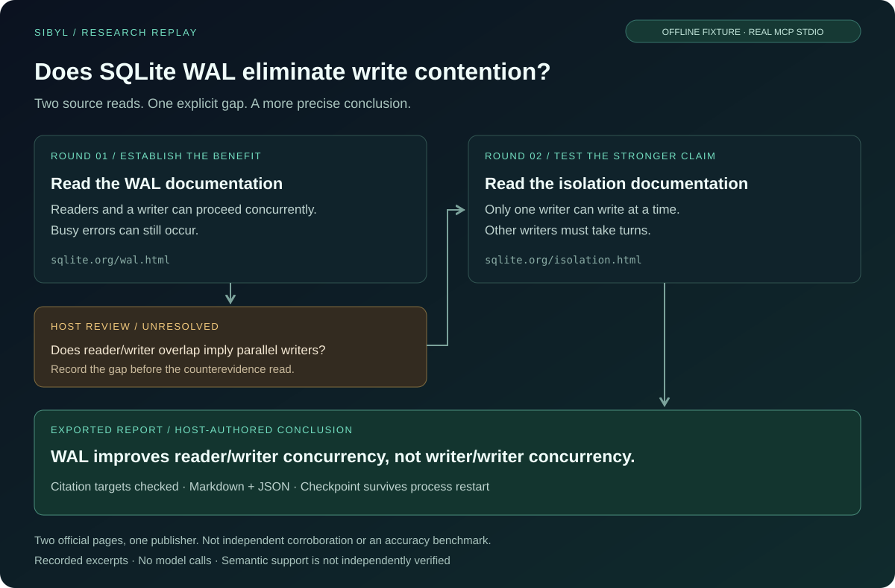

<!-- mcp-name: io.github.chriswu727/sibyl -->

# Sibyl

[English](README.md) | [Simplified Chinese](README.zh-CN.md)

**A research MCP for your AI agent: investigate across sources, inspect evidence,
track counterevidence and gaps, and export a cited report when needed.**

Your agent does the searching and thinking. Sibyl gives it a persistent research
workspace alongside its own search; it does not replace it.
Connect it to a local MCP-capable agent you already use, including one backed by
a subscription. Sibyl does not call another generative model, read subscription
credentials, or require a second model API key. The host's own usage rules still apply.

[Installation](#quick-start) · [Agent protocol](docs/agent-protocol.md) ·
[Design](docs/MCP_ARCHITECTURE.md) · [Documentation](docs/README.md) ·
[Quality limits](#quality-and-limitations)

> **Source preview, not a new PyPI release.** This README describes the host-only
> architecture in this checkout. Published beta 0.4.0b1 and stable 0.3.0 still
> contain the older architecture. Use the source installation below to try this
> version. No paired evaluation yet shows that adding Sibyl to your agent's own
> search yields better-supported answers.

## Research for the agent, reports for the person

A search call returns leads. Sibyl keeps the investigation connected:

- Break a question into research questions and retain the plan across calls.
- Read the pages your agent finds into one evidence store, or search keylessly.
- Inspect exact passages with stable identities, hashes and provenance.
- Reject fact claims whose quotes do not appear verbatim in the cited passage.
- Record supported, disputed or unresolved conclusions with evidence links.
- Investigate counterevidence and pursue specific gaps in subsequent rounds.
- Reuse the structured review ledger directly, or export Markdown, JSON or PDF.

The host chooses queries, reads sources and judges what they support. Sibyl
retrieves, preserves state, checks reference integrity and enforces budgets.
It does not decide truth for the host or run an autonomous researcher.

### When to use it

Use Sibyl when a conclusion must be checked or reused: a decision that needs
cited evidence, a comparison that should include counterevidence, an
investigation spanning several questions or sessions, findings handed to
someone else, or a report. For a quick fact lookup, your agent's own search is
enough. Sibyl adds steps; it pays off when the evidence trail matters.

The default MCP surface has **eight tools**, compact structured briefs and
on-demand passage reads. A research result does not need to become a long report
before another agent can use it.

## Quick start

Requires Python 3.11+ and a host supporting local stdio MCP. Agent-profile
results arrive in `structuredContent` and as the same JSON text, so hosts that
pass only text to the model still receive them. Install this source checkout in
a fresh environment:

```bash
git clone https://github.com/chriswu727/sibyl.git
cd sibyl
python -m venv .venv
.venv/bin/python -m pip install -e .
.venv/bin/sibyl-mcp --list-tools
```

The last command should show `profile: agent` and eight tools. Add this to your
host's MCP configuration, replacing both paths with absolute local paths.
`SIBYL_OUTPUT_ROOT` is optional; without it, research is stored in your per-user
data directory and shared by your local sessions:

```json
{
  "mcpServers": {
    "sibyl": {
      "command": "/absolute/path/to/sibyl/.venv/bin/sibyl-mcp",
      "env": {
        "SIBYL_OUTPUT_ROOT": "/absolute/path/to/private-sibyl-research"
      }
    }
  }
}
```

On Windows, use `.venv\\Scripts\\sibyl-mcp.exe`. Configuration syntax varies by host;
the example is for clients accepting `mcpServers` JSON. Integrations that want
readable text can use `"args": ["--profile", "keyless"]` for the twelve-tool
compatibility surface and full text responses. This is not a remote HTTP MCP endpoint.

No search key is required. Optional Tavily search has separate credentials and
provider charges; subscription access to your agent does not pay for Tavily.
See [installation and optional integrations](llms-install.md).

Try asking your agent:

> Use Sibyl to investigate whether SQLite WAL fits a multi-process application.
> Inspect the original documentation, investigate limitations and counterevidence,
> and return evidence-linked conclusions with unresolved questions. Write a report
> only if I ask for one.

## Research workflow

| Tool | Purpose |
|---|---|
| `start_research` | Create a bounded job with focused sub-questions |
| `continue_research` | Read a URL your agent found, or search keylessly, into the job |
| `get_research` | Read the brief, exact passages in a batch, source catalog or full state |
| `assess_research` | Record the host's conclusion, support, challenges and gaps |
| `complete_research` | Optionally finalize a cited host-authored report |
| `save_report` | Export that report; Markdown is the default |
| `cancel_research` | Cancel work or explicitly delete a checkpoint |
| `gather_bundle` | Retrieve standalone evidence without creating a job |

Start with `question` and `sub_questions`. Find sources with your agent's own
search when it has one and read them with `continue_research(url=..., query=...)`;
a query alone uses Sibyl's keyless search. Link each retrieval to `question_id`;
use `purpose="counterevidence"` for an actual investigation of alternatives.
The brief intentionally omits raw text: read up to twelve passages at once with
`get_research(job_id, passage_ids=[...])` before assessing support.

Each assessment preserves stable supporting/challenging passage IDs, a conclusion
and optional `follow_up_queries`. Inspect `research_plan` for remaining gaps,
continue with a focused query and rationale, then reassess. Use
`get_research(view="sources", revision=..., offset=0, limit=10)` to page evidence
outside the selected citation window.

New MCP jobs also record material facts, inferences and recommendations in
`assess_research(claims=...)`. Facts link exact passages and quote them;
Sibyl rejects a quote it cannot find in the cited passage, ignoring only case,
spacing, accent encoding and typographic variants; numbers are never folded. Reasoning links its premises; recommendations
state criteria and assumptions. Unknowns stay explicit.
Changes to a premise or new retrieval make dependent judgments need reassessment.
See the [claim contract and complete example](docs/research-claims.md).

Reports are optional. For a new job, submit `complete_research` with the current
revision and optional `claim_ids`, then `save_report(job_id=..., format="md")`.
For JSON as well, call `save_report` again with `format="json"` and use its returned
path. The legacy `format="both"` means PDF plus Markdown, not Markdown plus JSON.
Agent exports return a machine-readable manifest with confirmed file paths,
formats, sizes, hashes and per-format failures. Errors expose recovery instructions
and the current saved revision when available; rejected claims are never silently
accepted. See the [agent protocol](docs/agent-protocol.md#structured-recovery).
Sibyl renders the host-authored claims and citations, including their premises,
criteria and assumptions. Unknown/disputed claims remain visible even if omitted
from the selection. Old saved jobs retain prose-based completion.
Citation validation checks targets, **not whether the text entails the claim**.
Incomplete research must retain its gaps; `allow_incomplete=true` yields a partial
report. A completed job means the report is finalized, not that its claims are true.

[Detailed workflow and limits](docs/USAGE.md#persistent-research-jobs) ·
[Machine-facing contract](docs/agent-protocol.md)

### See the investigation

[](docs/examples/sqlite-wal/README.md)

[Read the report](docs/examples/sqlite-wal/report.md) ·
[Inspect the evidence](docs/examples/sqlite-wal/sources.json) ·
[Reproduce the replay](docs/examples/sqlite-wal/README.md)

This is a recorded-source MCP replay with host-authored reasoning, not a live
accuracy benchmark. It checks gap reviews, counterevidence, exports and restart.
The [ten-case live host suite](docs/examples/host-suite/README.md) separately
documents discovery failures, host-supplied URLs and explicit abstention.

## Optional capabilities

```bash
.venv/bin/python -m pip install -e '.[pdf]'      # text-PDF input; POSIX only
.venv/bin/python -m pip install -e '.[report]'   # PDF output, no model SDK
.venv/bin/python -m pip install -e '.[monitor]'  # authenticated loopback monitoring
```

Markdown and JSON export need no extra. `[extract]` supplies Trafilatura for
compatibility reads; `[rerank]` supplies optional local FlashRank ranking.
The default lexical ranker needs no model download. See
[usage](docs/USAGE.md) and [operations](docs/OPERATIONS.md).

For inspection outside an agent, use `sibyl gather "a focused question" --format json`
or the async Python `sibyl.gather_bundle` API. Neither generates an answer.

## Upgrading from the old architecture

LiteLLM, model-provider configuration, autonomous execution, generic model analysis,
SWOT/timeline generation and finance/chart tools have been removed.
The `report` extra now means PDF rendering only. Use `agent` (default) or
`keyless`; old `report`, `finance` and `full` profiles are rejected.

Install in a fresh virtual environment: upgrading a package does not uninstall
its old transitive dependencies. Remove old model settings from `SIBYL_CONFIG`.
Do not give Sibyl your host's login token. Existing checkpoints remain readable
and completed reports exportable; old autonomous jobs cannot resume execution.
Start a new host job to continue investigating. See [migration](docs/USAGE.md#migration).
The [legacy-boundary inventory](docs/MIGRATION.md) distinguishes removed execution
from retained checkpoint/report readers and historical evaluation evidence.

## Quality and limitations

The practical difference is **persistent, evidence-directed research**, not a
claim to have a better model. Whether it produces better answers than built-in
search still needs a paired same-host, same-provider, same-budget evaluation.

The latest [live retrieval run](evals/results/live-retrieval-hedged-2026-10-27.json)
tested 66 questions three times on a GitHub-hosted runner. It handled every trap
question safely but failed answer coverage (74.1% vs 80%), answerable readiness
(35.2% vs 75%), repeat stability (48.5% vs 90%) and ready-state answer precision
(90.5% vs 95%). From that datacenter network, DuckDuckGo and Mojeek almost always
refused keyless requests. These use gold/alias evidence matching, not semantic report
accuracy. Seven of ten live host-suite cases needed host-supplied
URLs. Compact responses and model removal do not fix those discovery weaknesses.
No full pass of this gate is recorded. A [two-workflow low-effort host retest](evals/results/host-agent-structured-retest-2026-10-26.json)
delivered partial Markdown/JSON for both tasks, but the SQLite recommendation
still cited an excerpt missing a material qualification. Export success is not
a semantic research-quality pass. Verbatim quote checks were added afterwards:
an invented or misplaced quote is now rejected, but a real quote can still
overstate a claim. A [two-task Claude Code paired smoke](evals/results/host-claude-code-paired-2026-10-27.json)
(one run per condition, not blinded) split one win and one loss: with Sibyl the
host quote-verified every supported fact and found a material SQLite corruption
bug the built-in-search baseline missed, but on the NVIDIA question it chose
weaker sources than the baseline, at roughly five times the cost. This is not a
superiority result.

Search bundles select up to three disjoint passages per source from the bounded
extracted text, using Unicode lexical matches and prose/table context rather than
heading hits alone. For missing sections, use `continue_research(url=..., query=...)`:
the direct read extracts up to 60,000 characters and returns at most 16,000 evidence
characters. Exact offsets/hashes are retained; omitted sections remain unread.
These are relevance heuristics, not semantic support checks or translation.
Exact passage reads show the bounded source length, excerpt status and an
available budgeted read-more route. Inspect each qualification against its cited
text; these hints do not independently verify support or certify a complete read.
Known Crossref metadata and search snippets remain leads, not substantive text
or independent full-text domains for readiness. An HTML download can still be an
abstract or catalog entry; the host must inspect what was actually read.

Public search can throttle; original pages can block extraction. Source-kind,
recency and duplicate-cluster labels are heuristics. PDFs are bounded text reads,
not OCR or guaranteed table extraction. Retrieved text can contain prompt
injection: the host must treat it as untrusted evidence, never instructions.

State is private local SQLite storage under the output root's `.research`
directory, with explicit deletion and bounded quotas, not automatic expiry or
encryption. The output root is `SIBYL_OUTPUT_ROOT`, or your per-user data
directory when unset; an older `./reports` store is never moved. Your local
sessions share it: a job running in one session is read-only in the others.
It is one user's shared research space, not isolation between projects. See
[shared research store](docs/USAGE.md#shared-research-store). Public-network checks, revision checks
and controlled exports reduce risk; they do not turn Sibyl into a sandbox.

Claim-based human reports present conclusions and reasoning once; JSON retains
the full compatible ledger. PDF export requires font coverage for the actual text.
Unsupported glyphs or failed rendering return an explicit export failure instead
of saving an incomplete-looking-successful PDF. Markdown/JSON remain available.

[Release evidence](docs/LAUNCH_READINESS.md) · [Roadmap](docs/QUALITY_BUILD_PLAN.md) ·
[Security](SECURITY.md) · [Privacy](PRIVACY.md)

The [refactor goals](docs/REFACTOR_GOALS.md) define the intended evidence,
inference and recommendation contract, with current capabilities separated from
planned work. Traceable evidence is the goal; zero hallucinations is not a guarantee.

## Contributing

Use [CONTRIBUTING.md](CONTRIBUTING.md) for offline tests, real MCP replay,
clean-wheel checks and dependency audits. Paid evaluations require explicit
authorization. [Architecture](docs/MCP_ARCHITECTURE.md) describes module ownership.

[Changelog](CHANGELOG.md) · [MIT license](LICENSE)
