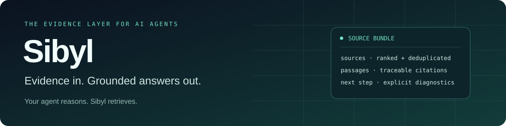
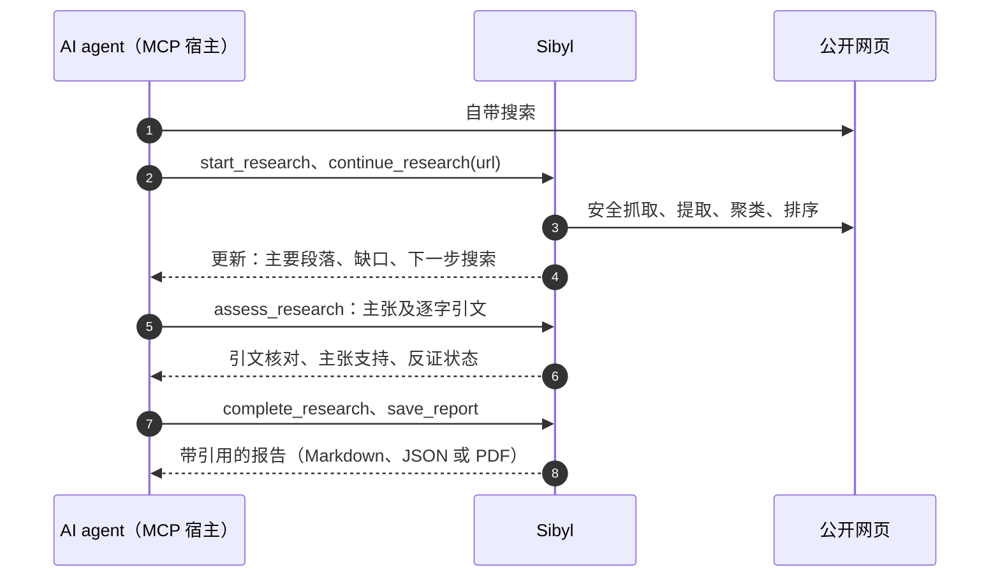

<p align="center">
  
</p>

<p align="center">
  <a href="https://github.com/chriswu727/sibyl/actions/workflows/tests.yml"></a>
  
  
  
  <a href="LICENSE"></a>
</p>

<p align="center">
  <a href="README.md">English</a> · <b>简体中文</b>
  <br>
  <a href="#快速开始">快速开始</a> ·
  <a href="#工作原理">工作原理</a> ·
  <a href="#研究流程">研究流程</a> ·
  <a href="#质量目标和当前限制">评测</a> ·
  <a href="docs/README.md">文档</a>
</p>

**为你现有的 AI agent 提供研究能力的 MCP：跨来源调查、检查证据、追踪反证和研究缺口，并在需要时导出带引用的报告。**

你的 agent 负责搜索和思考，Sibyl 在它自带的搜索之外提供持久化的研究工作区，并不替代它的搜索。它可以连接支持本地 MCP 的 agent，
包括通过订阅使用的 agent。Sibyl 不调用另一个生成式模型，不读取订阅凭证，也不需要第二个模型 API key。
宿主的订阅规则、额度限制和隐私条款仍然适用。

本文件是仓库唯一维护的中文文档。英文 README、功能目标和实施计划是规范版本。

> [!NOTE]
> **状态（2026-10-28）：已暂停开发，不计划发布正式版。**
> 预先登记的配对评测两次运行均未通过：合并两次结果，使用 Sibyl 的 agent 所引来源支持其结论的比例略高（79.4%，只用内置搜索时为 74.9%），
> 成本约为两倍，差异在两次运行之间的随机波动范围内（[详情](#质量目标和当前限制)）。agent 自身的调研能力已经赶上了 Sibyl 当初想补足的部分。
> 本文描述源码版本；已发布的 beta 0.4.0b1 和稳定版 0.3.0 是更早的架构。

## 能做什么

一次搜索返回线索，Sibyl 将调查过程连接起来。

| 环节 | Sibyl 做什么 |
|---|---|
| **规划** | 将问题拆成研究子问题，并跨多次调用保存计划。 |
| **读取** | 把 agent 自己找到的页面读入同一份证据库，也可以使用免 key 搜索。 |
| **溯源** | 按需检查原文段落、稳定标识、内容哈希和来源信息。 |
| **核对** | 事实主张引用的原文如果不在所引段落中逐字出现，直接拒绝。 |
| **结论** | 保存有支持、有争议或未解决的判断及其证据链接。 |
| **反证** | 调查反证，围绕具体缺口继续检索。 |
| **交付** | 直接复用结构化研究结果，或导出 Markdown、JSON 和 PDF。 |

宿主决定查什么、阅读证据并判断它支持什么。Sibyl 负责检索、保存状态、检查引用关系和限制资源使用。
它不替宿主判断绝对真伪，也不独立运行一个研究 agent。

**什么时候用：** 当结论需要被核对或复用时，例如需要引用证据的决策、应当考虑反证的比较、
跨多个问题或多次会话的调查、要交给别人的结论，或需要一份报告。
只是快速查一个事实时，agent 自带的搜索就够了：Sibyl 会增加步骤，证据链重要时才值得。

## 工作原理



默认 MCP 入口提供 **8 个工具**，返回紧凑的结构化简报；每次读取或评估后返回单个问题的更新，原文按需读取。
研究结果不需要先变成一篇长报告，才能被后续任务使用。

## 快速开始

需要 Python 3.11+，以及支持本地 stdio MCP 的宿主。请使用全新的虚拟环境安装源码：

```bash
git clone https://github.com/chriswu727/sibyl.git
cd sibyl
python -m venv .venv
.venv/bin/python -m pip install -e .
.venv/bin/sibyl-mcp --list-tools   # 应列出 8 个工具
```

把 Sibyl 加入宿主的 MCP 配置，并将两个路径替换为本机的绝对路径。`SIBYL_OUTPUT_ROOT` 可省略；
省略时研究数据保存在当前用户的数据目录，由本机的多个会话共享：

```json
{
  "mcpServers": {
    "sibyl": {
      "command": "/absolute/path/to/sibyl/.venv/bin/sibyl-mcp",
      "env": {
        "SIBYL_OUTPUT_ROOT": "/absolute/path/to/private-sibyl-research"
      }
    }
  }
}
```

然后可以这样对你的 agent 提问：

> 用 Sibyl 调查 SQLite WAL 是否适合一个多进程应用。阅读原始文档，调查限制和反证，
> 返回与证据关联的结论及未解决的问题。只有我要求时才生成报告。

<details>
<summary><b>Windows、搜索 key 和传输方式说明</b></summary>

- Windows 的可执行文件位于 `.venv\Scripts\sibyl-mcp.exe`。具体配置语法取决于宿主，示例适用于接受 `mcpServers` JSON 的客户端。
- 结果以 MCP `structuredContent` 返回，并同时附上相同的 JSON 文本，只把文本交给模型的宿主也能拿到完整结果。
  原有的 `--profile keyless` 文本兼容入口已移除。这不是远程 HTTP MCP 服务。
- 默认搜索不需要 key。可选 Tavily 搜索使用独立凭证，并可能产生额外费用；agent 的订阅不包含 Tavily 的费用。
  参见[安装说明](llms-install.md)。

</details>

## 研究流程

| 工具 | 用途 |
|---|---|
| `start_research` | 创建有预算限制的持久化研究任务和子问题 |
| `continue_research` | 将 agent 找到的 URL 读入任务，或使用免 key 搜索 |
| `get_research` | 读取简报、批量读取原文段落、来源目录或完整状态 |
| `assess_research` | 保存宿主的判断、支持证据、挑战证据和缺口 |
| `complete_research` | 按需定稿带引用的宿主报告 |
| `save_report` | 导出报告，默认 Markdown |
| `cancel_research` | 取消工作，或显式删除任务记录 |
| `gather_bundle` | 不创建任务，直接检索一份证据包 |

1. **创建**：提供 `question` 和 `sub_questions`。
2. **读取**：用 agent 自带搜索找到来源，再用 `continue_research(url=..., query=...)` 读入任务；
   只提供 query 时使用 Sibyl 的免 key 搜索。每轮检索关联 `question_id`，调查相反证据时使用
   `purpose="counterevidence"`。每次读取返回一份更新：新来源的主要段落直接内联，并附上该问题的缺口和下一步搜索建议。
3. **查看原文**：完整简报省略原文，评估前用 `get_research(job_id, passage_ids=[...])` 一次读取最多 12 个完整段落。
4. **评估**：提交稳定的支持/挑战段落 ID、结论和主张。事实关联原文段落并逐字引用，Sibyl 在所引段落中找不到引文时会拒绝；
   推理关联所依据的主张，推荐保留标准与假设，未知信息保持明确。参见[主张与证据协议](docs/research-claims.md)。
5. **迭代**：针对 `research_plan` 中的缺口，说明理由并继续定向检索，然后重新评估。
6. **报告**（按需）：向 `complete_research` 提交当前 revision，再调用 `save_report(job_id=..., format="md")`。

<details>
<summary><b>评估、报告和错误恢复的更多说明</b></summary>

引文匹配仅忽略大小写、空白、重音编码和排版符号差异，数字不做归一。
基础事实改变或出现新检索时，依赖它的判断也需要复核。
使用 `get_research(view="sources", revision=..., offset=0, limit=10)` 可以分页查看当前引用窗口之外的已保存来源。

还需要 JSON 时，再调用一次 `save_report(format="json", job_id=...)` 并使用返回的路径，不能通过替换后缀猜测文件路径。
导出结果会列出已确认的真实路径、格式、大小、哈希及各格式的失败信息；
请求失败时也会返回结构化修复指引和可读取到的当前 revision，不会悄悄接受无效主张。

报告从宿主已经记录的主张生成，自动带入引用、前提、标准和假设；未被选择的未知或争议信息仍然保留。
旧版（contract-1）任务不能再定稿，已完成的仍可读取和导出。
引用检查验证目标是否存在，**不证明原文支持该主张，更不保证主张符合现实**。
研究不完整时必须保留缺口；`allow_incomplete=true` 会产生 partial 报告。
任务 completed 表示报告已定稿，不代表所有结论都正确。定稿报告不可修改。

[详细用法和限制](docs/USAGE.md#persistent-research-jobs) · [Agent 协议](docs/agent-protocol.md)

</details>

### 查看完整示例

[](docs/examples/sqlite-wal/README.md)

<p align="center">
  <a href="docs/examples/sqlite-wal/report.md">阅读报告</a> ·
  <a href="docs/examples/sqlite-wal/sources.json">检查证据</a> ·
  <a href="docs/examples/sqlite-wal/README.md">复现回放</a>
</p>

这是使用已记录来源和宿主撰写推理的 MCP 回放，不是实时准确率评测。
它检查研究缺口、反证调查、导出和重启恢复。
[十案例实时宿主研究记录](docs/examples/host-suite/README.md)
另外披露了来源发现失败、宿主提供 URL 和明确拒绝下结论的情况。

## 可选能力

```bash
.venv/bin/python -m pip install -e '.[pdf]'      # 读取文本 PDF，仅支持 POSIX，不做 OCR
.venv/bin/python -m pip install -e '.[report]'   # PDF 导出，不包含模型 SDK
.venv/bin/python -m pip install -e '.[monitor]'  # 需显式启用和认证的本地运行监控
```

Markdown 和 JSON 导出不需要额外依赖。`extract` 为兼容读取工具提供 Trafilatura；`rerank` 提供可选的本地 FlashRank 排序。
默认词法排序无需下载模型。参见[用法](docs/USAGE.md)和[运行指南](docs/OPERATIONS.md)。
不通过 agent 时，可以使用 `sibyl gather "a focused question" --format json`
或异步 Python API `sibyl.gather_bundle` 检查证据；它们都不会生成答案。

<details>
<summary><b>从旧架构升级</b></summary>

源码已经移除 LiteLLM、模型提供商配置、自主执行、通用模型分析、SWOT/时间线生成和金融/图表工具。
`report` 扩展现在仅表示 PDF 渲染。Sibyl 只提供一套工具；
旧的 `keyless`、`report`、`finance` 和 `full` profile 会被拒绝。

建议新建虚拟环境：升级软件包不会自动卸载旧的间接依赖。
删除 `SIBYL_CONFIG` 中的旧模型设置，不要把宿主登录 token 交给 Sibyl。
已有任务仍可读取，已完成报告仍可导出；旧 autonomous 任务不能继续执行。
如需继续调查，请新建 host 任务。参见[迁移说明](docs/USAGE.md#migration)。
[兼容边界清单](docs/MIGRATION.md)区分已经删除的执行能力、保留的旧数据读取能力和历史评测证据；
[现行架构](docs/MCP_ARCHITECTURE.md)记录新设计及模块职责。

</details>

## 质量目标和当前限制

Sibyl 的差异是持久化、由证据推动的研究流程，不是拥有更强的模型。下面每一道门槛都在运行前冻结，未通过的运行也全部保留。

| 评测 | 结果 |
|---|---|
| [宿主来源检索门槛](evals/results/host-source-retrieval-honest-ua-2026-10-27.json)（66 个问题，每题三个固定 URL） | 满足修订后的门槛：答案覆盖率 87.0%、稳定性 98.5%、ready 状态答案精度 100%。可回答问题的 ready 比例 30.2%，经维护者决定改为只报告的诊断指标。 |
| [配对宿主评测，第一次](evals/results/paired-host-2026-10-27/manifest.json)（20 个任务，盲评） | 未通过：引文支持率 78.6%，内置搜索为 69.1%；但反证覆盖评分较低（1.1 对 1.4）。 |
| [配对宿主评测，第二次](evals/results/paired-host-rerun-2026-10-28/manifest.json) | 未通过：引文支持率 80.2% 对 80.5%，事实题少答对一题。 |
| 两次配对评测合并 | 引文支持率 79.4% 对 74.9%（读不到的页面计为无支持时为 77.5% 对 67.4%）；事实题和陷阱题结果相同；成本约为两倍。 |
| [免 key 来源发现](evals/results/live-retrieval-hedged-2026-10-27.json)（66 个问题 × 3，GitHub 运行器） | 未通过：覆盖率 74.1%、ready 比例 35.2%、稳定性 48.5%、ready 精度 90.5%；陷阱问题全部安全处理。 |

两次配对评测之间，只用内置搜索的引文支持率本身就变化了 11 个百分点，因此单次 20 题的运行无法分辨几个百分点的差异。

<details>
<summary><b>完整质量说明</b></summary>

宿主来源检索门槛的[首次运行](evals/results/host-source-retrieval-2026-10-27.json)时，页面读取尚未以 Sibyl 身份标识，所有 Wikipedia 读取都被拒绝。
免 key 来源发现中，在该数据中心网络上，DuckDuckGo 和 Mojeek 几乎总是拒绝请求。
这些检索门槛依据标准答案/别名在证据中的匹配，不是报告语义准确率。
十案例实时宿主研究中，有七个案例需要宿主提供 URL。精简接口和删除内置模型并未自动解决这些来源发现问题。

[两次低 effort 宿主复测](evals/results/host-agent-structured-retest-2026-10-26.json)
都成功交付了 partial 状态的 Markdown/JSON，但 SQLite 推荐仍有一个重要限定条件未被所引片段支持。
导出成功不代表研究语义质量通过。此后加入了逐字引文检查：编造或放错段落的引文会被拒绝，但真实引文仍可能被过度解读。
一次[两个任务的 Claude Code 配对小测](evals/results/host-claude-code-paired-2026-10-27.json)（每个条件各跑一次，非盲评）
结果一胜一负：使用 Sibyl 时，宿主为每条有支持的事实都核对了原文引句，并发现了只用内置搜索的基线漏掉的一个严重 SQLite 损坏 bug；
但在 NVIDIA 问题上，它选到的来源比基线弱，成本约为基线的五倍。

检索会从有长度限制的提取正文中为每个来源选择最多三个不重叠片段，结合 Unicode
关键词和正文、表格语境，而不是只匹配目录标题。缺少章节时可用
`continue_research(url=..., query=...)` 定向读取：最多提取 60,000 字符，返回证据不超过
16,000 字符，保留准确位置和哈希；未返回的部分仍视为未读。这些是相关性启发式，
不等于语义支持校验，也不会自动翻译查询。
精确片段读取会显示有界来源长度、是否为摘录，以及预算允许时的进一步读取入口。
每项限定条件仍需逐一核对引用原文；这些提示不等于独立语义校验或完整阅读证明。
已标明的 Crossref 元数据和搜索摘要保留为线索，不计入就绪判断的实质正文或独立正文域名。
下载到 HTML 也可能只是摘要或目录记录，宿主仍需检查实际证据范围。

公共搜索可能限流，页面可能阻止读取。来源分类、时间和重复内容判断都是启发式信号。
PDF 读取有资源与长度限制，不保证表格和公式还原。
来源文本可能包含提示注入，宿主必须将其视为不可信证据，而不是指令。

研究状态保存在输出根目录的 `.research` 下的本地 SQLite 中，有容量限制和显式删除机制，
但不自动过期，也不进行静态加密。输出根目录为 `SIBYL_OUTPUT_ROOT`；未设置时使用当前用户的数据目录，
旧的 `./reports` 不会被移动。同一用户的本地会话共享这份存储：某个会话正在运行的任务，
在其他会话中只读。这是同一用户的共享研究空间，不是项目之间的隔离。
详见[共享研究存储](docs/USAGE.md#shared-research-store)。网络检查、revision 检查和
导出限制降低风险，但不等于安全沙箱。

基于结论记录的人读报告只呈现一次结论和推理，JSON 保留完整兼容记录。
PDF 导出需要字体覆盖实际文本；缺少字形或渲染失败时会明确报错，不再保存缺少正文却显示成功的文件。
此时仍可使用 Markdown/JSON。

[重构功能目标](docs/REFACTOR_GOALS.md)明确区分事实、推断、推荐和未知，并标明已实现与计划中的能力。
我们追求每个重要结论都有可核查的依据，不承诺“百分百真实”或“零幻觉”。

</details>

[发布证据](docs/LAUNCH_READINESS.md) · [实施计划](docs/QUALITY_BUILD_PLAN.md) ·
[安全](SECURITY.md) · [隐私](PRIVACY.md)

## 参与开发

参见 [CONTRIBUTING.md](CONTRIBUTING.md) 中的离线测试、真实 MCP 回放、干净安装检查和依赖审计。
付费评测需要明确授权。[架构说明](docs/MCP_ARCHITECTURE.md)记录各模块的职责。

<p align="center">
  <a href="CHANGELOG.md">更新日志</a> · <a href="LICENSE">MIT 许可证</a>
</p>
