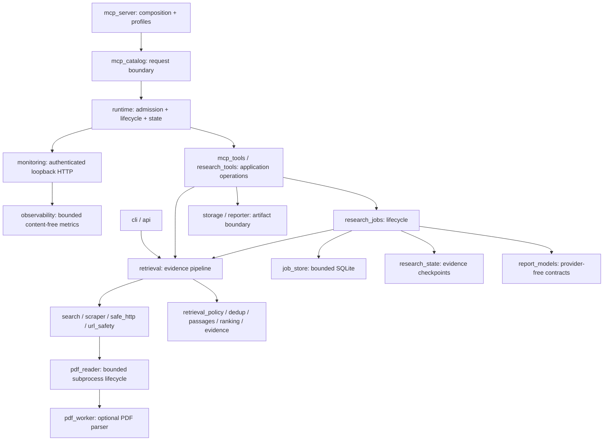

# Host-only research architecture

Sibyl is a local, asynchronous research application with MCP, CLI, and Python
interfaces. It is not a hosted or multi-tenant service. Research jobs persist
public-web evidence, host judgments and optional reports. The host is the only
supported execution mode and owns planning, semantic judgment and writing. There
is no internal generative-model execution. This document specifies current source,
not the older published packages; [migration](MIGRATION.md) defines the retained
legacy-data boundary.

## Product contract

The primary deliverable is reusable research state for the calling agent. A human
report is an optional projection of that state, not a second research pipeline.
The agent decides what to investigate and what the evidence supports; Sibyl owns
retrieval, provenance, persistence, revision/reference integrity and bounded exports.
See [functional goals](REFACTOR_GOALS.md) for acceptance criteria and non-goals.

New MCP investigations use claim contract 2. The host starts a job, retrieves
evidence for named questions, reads exact passages, records atomic facts and
derived judgments, investigates counterevidence and reassesses gaps. Retrieval
or premise changes make affected reviews stale. Optional completion selects
claims, includes transitive premises and all unknown/disputed claims, and freezes
the report. Export returns only confirmed artifacts. Structured errors expose
safe reload/repair guidance rather than silently accepting an invalid revision.

These checks prove record consistency, not semantic entailment or factual truth.
Every factual qualification still needs actual support in the cited passage.
Search snippets and known scholarly metadata are leads, not full-text reads;
bounded excerpts do not establish that an entire document has been inspected.

## Module boundaries

| Module | Owns |
|---|---|
| `mcp_server.py` | Server construction, profile selection, console startup |
| `mcp_catalog.py` | Tool registration, runtime binding, public error boundary |
| `mcp_errors.py` | Structured agent validation/revision recovery and safe exception projection |
| `mcp_tools.py` | Tool schemas and application-level orchestration |
| `research_tools.py` | Persistent research tool schemas and delegation to job operations |
| `runtime.py` | Policy, lazy configuration, per-server state, execution lifecycle |
| `monitoring.py`, `observability.py` | Read-only authenticated HTTP lifecycle and bounded operational metrics |
| `pdf_reader.py`, `pdf_worker.py` | Parser process supervision and isolated optional text-PDF extraction |
| `async_cache.py` | Event-loop-local single-flight, TTL, capacity, waiter cancellation |
| `evidence_loop.py` | Bounded evidence workflow state machine |
| `retrieval.py` | Search/extraction/ranking coordination |
| `retrieval_policy.py` | Deterministic query constraints, source identity, and evidence sufficiency rules |
| `evidence.py` | Versioned source, passage, diagnostic, and loop contracts |
| `url_safety.py`, `safe_http.py` | Destination validation and DNS-pinned connections |
| `scraper.py` | Redirects, bounded decoding, extraction, optional Jina fallback |
| `report_models.py` | Report data contracts without importing an LLM SDK |
| `report_text.py` | Plain-text report presentation shared by CLI and MCP |
| `job_models.py` | Typed job records, states, retrieval attempts, evidence reviews, and research plans |
| `research_state.py` | Shared checkpoints, budgets, cross-query evidence selection |
| `source_policy.py` | Heuristic source classification and primary/academic routing priority |
| `research_sources.py` | Budgeted direct-page evidence with stable hashes and passage offsets |
| `research_review.py` | Host evidence links, per-question gaps, stale reviews, completion gates |
| `research_claims.py` | Atomic claim validation, dependency freshness, criteria and claim-derived report narrative |
| `research_errors.py` | Application-authored validation errors safe for the MCP boundary |
| `research_jobs.py` | Host job lifecycle, progress, cancellation, continuation |
| `job_store.py` | Private bounded SQLite shared by local runtimes, instance locks, job claims, orphan recovery, optimistic revisions |
| `report_audit.py` | Deterministic citation-target validation |
| `research_views.py` | Compact briefs, revision-pinned source pages and compatibility views |
| `report_sections.py`, `report_references.py` | Shared claim presentation and cited/background source grouping |
| `report_exports.py` | Per-format export results, actual artifact paths, hashes and failures |
| `storage.py` | Output-root policy, private staging, atomic publication |
| `privacy.py` | Display-only URL metadata redaction |

Retained retrieval exports in `mcp_server` preserve Python import compatibility.
Removed model/finance modules are not compatibility shims. Import `Source` and
`ResearchReport` from `report_models`; historical records retain their model fields
for reading and exporting, not for resuming old execution.

The catalog holds tool definitions, not per-client job or report state. Persistent
handlers register through the same catalog as the compatibility tools; runtime
binding remains per invocation. Existing exports in `mcp_tools` and `mcp_server`
remain available after handler extraction.

Static checking covers job models, persistence, notebook state, reviews, and job
orchestration. Typed dictionaries preserve the existing JSON checkpoint shape;
they are not runtime validation of arbitrary database files. Serialized source
and report payloads remain dynamic boundaries. The full repository is formatted
and linted; it is not fully strict-typed.

## Request lifecycle

1. MCP validates the registered schema.
2. The catalog binds the call to that server's runtime with a context variable.
   There is no shared mutable report/loop/cache state across server instances.
3. The runtime admits or rejects the call. Eight calls may run concurrently;
   a full runtime returns a retryable capacity error instead of building a queue.
4. A whole-operation deadline covers the tool coroutine, including its awaits:
   60 seconds per operation; jobs also have a 600-second cumulative active budget.
5. A normalized retrieval key coalesces identical in-flight bundle requests.
   Each key has a consumer count. The final departing consumer cancels the work.
   Failed results are not cached; successful/insufficient results expire after
   30 seconds, with at most 64 cached bundles.
6. The catalog returns known user-facing errors or an opaque provider-failure
   message. It does not serialize raw provider exceptions into MCP output.
7. Server lifespan shutdown cancels runtime-owned tasks, drains cache tasks,
   clears evidence loops, and releases the last report. Persistent jobs are
   interrupted and retained; startup never silently dispatches new work.

Runtime events expose tool name, outcome, duration, and active-call count as JSON
on stderr at `--log-level INFO`; the default is `WARNING`. Invocation completion
is not a research-quality verdict. Monitoring starts in MCP lifespan and stops
before runtime tasks and stores close. It does not start another server runtime,
initialize the lazy job store, or expose tool invocation over HTTP.

The library API deliberately remains a direct async operation: it does not hide
an ambient server runtime inside an embedding application. Library callers own
their concurrency, cancellation, and overall deadlines.

## State and consistency

Evidence loops use random IDs, a ten-minute TTL, a 64-entry cap, and per-loop
locks. Initial retrieval holds the lock too, so capacity pruning cannot evict an
active start. A cancelled/failed start removes its unfinished state.
The limit is four retrieval steps; the host supplies the atomic query plan.

Report exports are mutually exclusive within a runtime. MCP callers provide a
completed job ID; the runtime retains a programmatic last_report fallback for
existing Python integrations, but no MCP tool generates a report through a model.

New research jobs use a separate SQLite store, opened lazily below the output
root (the per-user data directory unless `SIBYL_OUTPUT_ROOT` is set). Concurrent
local runtimes share it. Each holds an OS file lock on its own instance file; a
running job records its claiming instance, other runtimes treat it as read-only,
and an orphan is recovered only after its owner's lock is free. Claims, recovery,
creation and deletion run in immediate transactions conditioned on the saved
revision. See [shared research store](USAGE.md#shared-research-store).
Each update uses an optimistic revision; host report submission must match the
current citation snapshot. Completed reports are immutable. Checkpoints store
plans, evidence, progress, budgets, and reports—not credentials or model sessions.

New host investigations link retrieval attempts to question IDs and an explicit
purpose. Direct reads and citation-following reads share the search budget.
Reviews pin supporting/challenging passages into the bounded report window;
later retrieval for a question makes its review stale. Completion requires a
review and a substantive counterevidence investigation per question, or explicit
incomplete delivery with the remaining gaps preserved. These checks validate
structure, not semantic truth, source independence, or research exhaustiveness.
Older host checkpoints retain their previous completion behavior. Old autonomous
records remain readable/exportable, but cannot resume execution.

Host retrieval runs as runtime-owned asyncio tasks; at most two jobs run at once
across every runtime sharing the store.
Shutdown cancels and awaits them before releasing the store. Explicit continuation
reuses completed evidence and consumed budgets.
This is checkpoint recovery, not exactly-once external execution. A process crash
can leave an in-flight attempt without a result; it remains budgeted.

Storage holds at most 64 jobs, 1 MiB per serialized job (plus 64 KiB reserved for
recovery metadata), and 16,384 SQLite pages. An oversized evidence checkpoint
retains the previous evidence and current consumed budgets, marks the discarded
attempt failed, and records an actionable event. Host jobs return to awaiting
input. Startup converts
unfinished attempts to failed without refunding their budgets. Physical disk or
database corruption failures are still surfaced; recovery cannot manufacture
durability when the underlying store cannot write.
Full history requires explicit checkpoint deletion. Progress retains 80 events.
Retrieval attempts are reserved before dispatch. The 600-second execution
budget accumulates across continuations; a crash can lose time since the last
checkpoint, but cannot reset persisted retrieval-attempt counters.
Legacy model counters remain in stored records; they are not new execution budgets.

UUIDs and separate runtime objects are not user authentication. Do not multiplex
mutually untrusted users into one stdio process.

## Security boundaries

Public-page fetches validate scheme, credentials, ports, hostnames, and resolved
addresses, then pin the connection to the validated IPs while preserving TLS SNI.
Every redirect is revalidated. Both wire bytes and decoded page bytes are capped
at 2 MiB. gzip/zlib-deflate decoding limits output allocation; unsupported stacked
encodings and truncated streams fail closed.

Only direct page fetching uses this pinned transport. Search services and
optional rendering services use their own outbound clients; they are separate trust
boundaries, not covered by a blanket "all networking is sandboxed" claim.

MCP exports are confined to an operator-selected root. Agents can request a
relative subdirectory, not an arbitrary absolute destination. Staging files are
private, output names are collision-resistant, and publication is an atomic
rename. The filesystem root must not be writable by untrusted local processes.
Exports have per-file and per-output-directory quotas checked under an OS-held
publication lock. Directory quotas are not a global filesystem resource boundary.

URL display redaction never mutates hashed passage text or offsets. Structured
evidence can contain sensitive material present in a public page; redaction is
not DLP. Sources can also contain prompt injection. The host must treat their
contents as data, not instructions.

See [SECURITY.md](../SECURITY.md) for limitations, including cooperative async
cancellation, blocking optional libraries, and OS-level resource isolation.

## Where new code belongs

- **New MCP operation:** implement persistent-job handlers in `research_tools`
  and other tools in `mcp_tools`, register the schema in the
  catalog, assign a profile, and add offline tool/serialization tests. Stateful
  report operations must join the runtime's exclusivity policy.
- **New search provider:** add an adapter in `search`, preserve transparent
  provider provenance and fallback behavior, and test without external calls.
- **New extractor or HTTP behavior:** use `scraper` and the existing network
  boundary. Do not bypass `safe_http` with a generic client for arbitrary URLs.
- **New ranking/sufficiency rule:** keep it in `ranking` or `retrieval_policy`;
  run lexical, pipeline, and source-quality regression gates.
- **New evidence field:** update the versioned contracts, schema fixture, docs,
  and serialization tests together. Preserve hash/offset consistency.
- **New export:** render from `report_models`; publish through `ArtifactStore`.
  Do not put model-provider imports into data contracts.
- **New research behavior:** extend `research_state` or `research_jobs`, keeping
  retrieval shared. Test interruption/resume and budget accounting. Persistence
  belongs in `job_store`, not MCP handlers.
- **New research quality gate:** extend `research_review`; keep source-type
  heuristics in `source_policy` separate from host reasoning. Export gaps and
  evidence links rather than silently converting missing evidence into success.
- **New runtime limit:** add it to `RuntimePolicy`, test exhaustion/cancellation,
  and document whether it applies to MCP only or the library API too.

## Design decisions

**Host reasoning, not hidden sampling.** Retrieval works in local stdio clients
without host sampling or another model credential. The host performs all planning,
semantic judgment and writing; Sibyl never reads its subscription credentials.

**Single process, local durability.** SQLite provides checkpoint persistence
without a task broker, cloud deployment, or tenant identity system.

**Fail-fast admission, not an unbounded queue.** A host can retry a busy call.
Predictable resource limits matter more than accepting work that cannot finish.

**Compatible contracts, explicit policy changes.** SourceBundle 1.6,
EvidenceLoop 1.0, and the eight-tool agent catalog have explicit consumer contracts.
The keyless compatibility profile exposes 12 tools. MCP output-directory
confinement and final-consumer cancellation are intentional behavioral changes.

**Tests are evidence, not a guarantee.** Unit tests and real stdio smoke tests
cover runtime and transport contracts. Offline retrieval fixtures prevent known
regressions. Dependency audits check known advisories in resolved installations.
Live accuracy claims still require a new dated live evaluation.

See the [documentation index](README.md), [operations runbook](OPERATIONS.md),
and [roadmap](QUALITY_BUILD_PLAN.md) for current usage and planned extensions.
