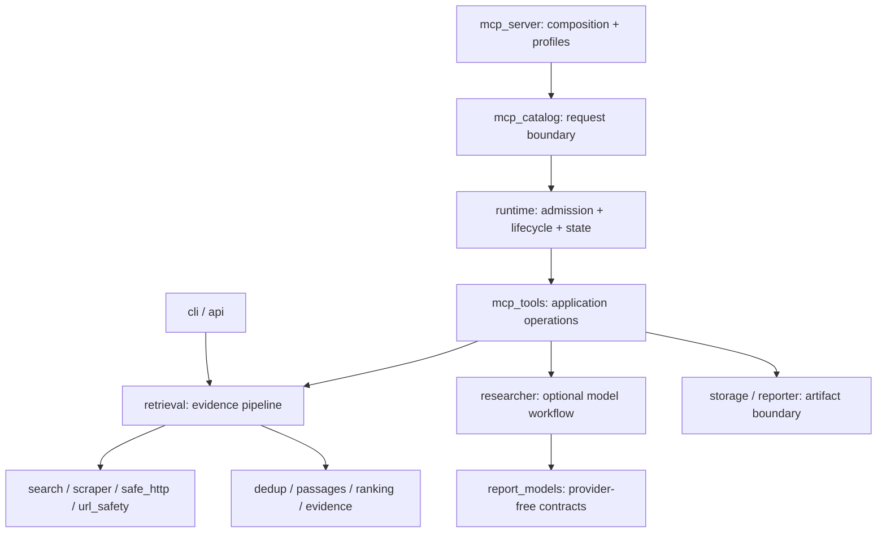

# Architecture

Sibyl is a local, asynchronous evidence-retrieval application with MCP, CLI, and
Python interfaces. It is not a hosted answer API or a multi-tenant service.
The default workload is public-web I/O followed by deterministic local processing.
The host owns planning, synthesis, and semantic judgment.

## Module boundaries

| Module | Owns |
|---|---|
| `mcp_server.py` | Server construction, profile selection, console startup |
| `mcp_catalog.py` | Tool registration, runtime binding, public error boundary |
| `mcp_tools.py` | Tool schemas and application-level orchestration |
| `runtime.py` | Policy, lazy configuration, per-server state, execution lifecycle |
| `async_cache.py` | Event-loop-local single-flight, TTL, capacity, waiter cancellation |
| `evidence_loop.py` | Bounded evidence workflow state machine |
| `retrieval.py` | Search/extraction/ranking coordination and evidence sufficiency |
| `evidence.py` | Versioned source, passage, diagnostic, and loop contracts |
| `url_safety.py`, `safe_http.py` | Destination validation and DNS-pinned connections |
| `scraper.py` | Redirects, bounded decoding, extraction, optional Jina fallback |
| `report_models.py` | Report data contracts without importing an LLM SDK |
| `storage.py` | Output-root policy, private staging, atomic publication |
| `privacy.py` | Display-only URL metadata redaction |

The retained tool exports in `mcp_server` preserve Python import compatibility.
The `Source` and `ResearchReport` names remain importable from `researcher`, but
new code should import their provider-independent definitions from `report_models`.

## Request lifecycle

1. MCP validates the registered schema.
2. The catalog binds the call to that server's runtime with a context variable.
   There is no shared mutable report/loop/cache state across server instances.
3. The runtime admits or rejects the call. Eight calls may run concurrently;
   a full runtime returns a retryable capacity error instead of building a queue.
4. A whole-operation deadline covers the tool coroutine, including its awaits:
   60 seconds normally, 180 seconds for model-assisted operations.
5. A normalized retrieval key coalesces identical in-flight bundle requests.
   Each key has a consumer count. The final departing consumer cancels the work.
   Failed results are not cached; successful/insufficient results expire after
   30 seconds, with at most 64 cached bundles.
6. The catalog returns known user-facing errors or an opaque provider-failure
   message. It does not serialize raw provider exceptions into MCP output.
7. Server lifespan shutdown cancels runtime-owned tasks, drains cache tasks,
   clears evidence loops, and releases the last report.

Runtime logs expose aggregate completion/failure/cancellation counts and tool
names through Python logging. They do not record arguments or page contents.
Logging defaults to `WARNING` so stdio protocol output remains clean.

The library API deliberately remains a direct async operation: it does not hide
an ambient server runtime inside an embedding application. Library callers own
their concurrency, cancellation, and overall deadlines.

## State and consistency

Evidence loops use random IDs, a ten-minute TTL, a 64-entry cap, and per-loop
locks. Initial retrieval holds the lock too, so capacity pruning cannot evict an
active start. A cancelled/failed start removes its unfinished state.
The limit is four retrieval steps; the host supplies the atomic query plan.

Optional report tools retain one successful report per runtime.
`research`, `save_report`, `fetch_market_data`, and `chart` are mutually exclusive:
an overlapping stateful call fails as busy instead of racing the latest report.
This preserves the existing `research` → `save_report` workflow without inventing
a database or durable report service.

This state is ephemeral and owned by one trusted local host. UUIDs and separate
runtime objects are not user authentication. Do not multiplex mutually untrusted
users into one stdio process.

## Security boundaries

Public-page fetches validate scheme, credentials, ports, hostnames, and resolved
addresses, then pin the connection to the validated IPs while preserving TLS SNI.
Every redirect is revalidated. Both wire bytes and decoded page bytes are capped
at 2 MiB. gzip/zlib-deflate decoding limits output allocation; unsupported stacked
encodings and truncated streams fail closed.

Only direct page fetching uses this pinned transport. Search services and
optional provider SDKs use their own outbound clients; they are separate trust
boundaries, not covered by a blanket "all networking is sandboxed" claim.

MCP exports are confined to an operator-selected root. Agents can request a
relative subdirectory, not an arbitrary absolute destination. Staging files are
private, output names are collision-resistant, and publication is an atomic
rename. The filesystem root must not be writable by untrusted local processes.

URL display redaction never mutates hashed passage text or offsets. Structured
evidence can contain sensitive material present in a public page; redaction is
not DLP. Sources can also contain prompt injection. The host must treat their
contents as data, not instructions.

See [SECURITY.md](../SECURITY.md) for limitations, including cooperative async
cancellation, blocking optional libraries, and OS-level resource isolation.

## Where new code belongs

- **New MCP operation:** implement it in `mcp_tools`, register its schema in the
  catalog, assign a profile, and add offline tool/serialization tests. Stateful
  report operations must join the runtime's exclusivity policy.
- **New search provider:** add an adapter in `search`, preserve transparent
  provider provenance and fallback behavior, and test without external calls.
- **New extractor or HTTP behavior:** use `scraper` and the existing network
  boundary. Do not bypass `safe_http` with a generic client for arbitrary URLs.
- **New ranking/sufficiency rule:** keep it in deterministic retrieval helpers;
  run lexical, pipeline, and source-quality regression gates.
- **New evidence field:** update the versioned contracts, schema fixture, docs,
  and serialization tests together. Preserve hash/offset consistency.
- **New export:** render from `report_models`; publish through `ArtifactStore`.
  Do not put model-provider imports into data contracts.
- **New runtime limit:** add it to `RuntimePolicy`, test exhaustion/cancellation,
  and document whether it applies to MCP only or the library API too.

## Design decisions

**Host reasoning, not hidden sampling.** Retrieval works in local stdio clients
without depending on host sampling support or another model credential. An
experimental report profile remains optional and explicit.

**Single process, not distributed infrastructure.** The current workload does
not require a database, task broker, cloud deployment, or tenant identity system.
Those would add operational obligations without improving this local contract.

**Fail-fast admission, not an unbounded queue.** A host can retry a busy call.
Predictable resource limits matter more than accepting work that cannot finish.

**Compatible contracts, explicit policy changes.** SourceBundle 1.6,
EvidenceLoop 1.0, and the 14-tool catalog remain intact. MCP output-directory
confinement and final-consumer cancellation are intentional behavioral changes.

**Tests are evidence, not a guarantee.** Unit tests and real stdio smoke tests
cover runtime and transport contracts. Offline retrieval fixtures prevent known
regressions. Dependency audits check known advisories in resolved installations.
Live accuracy claims still require a new dated live evaluation.
